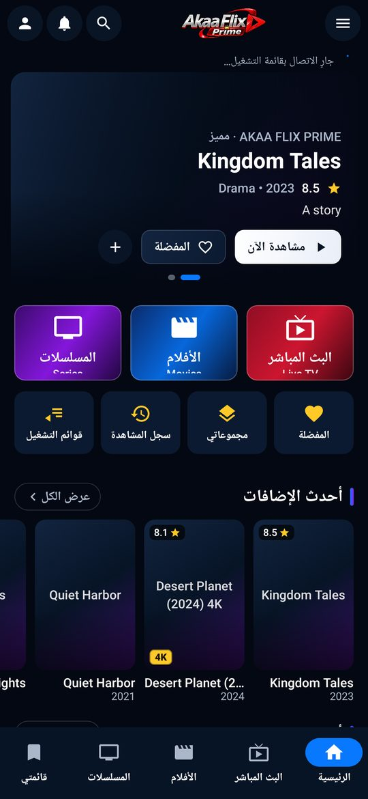
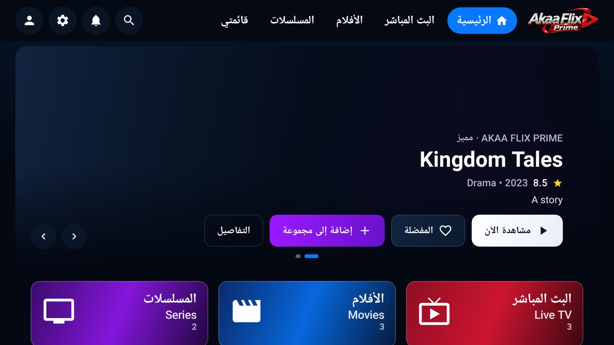
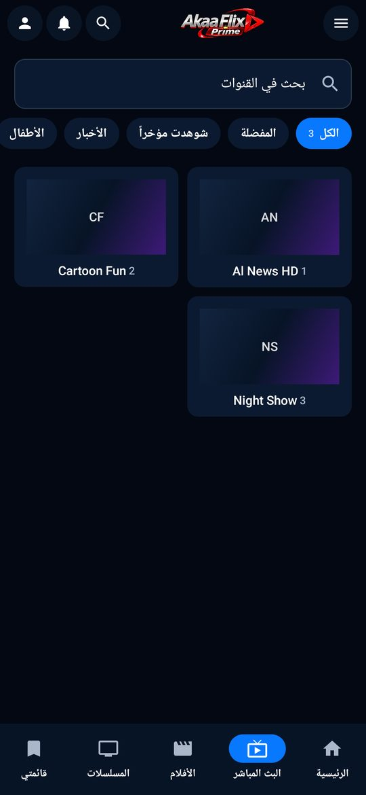
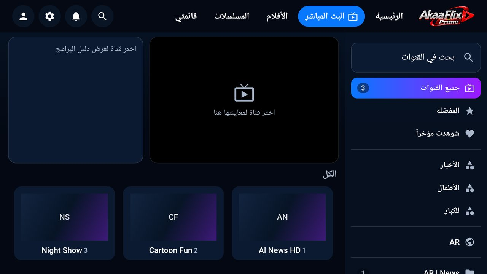

# Akaa Flix Prime

A premium IPTV player for **Android phones, tablets, Android TV and TV boxes**, built with Kotlin and
Jetpack Compose. It connects to **Xtream Codes** playlists only (no M3U) and plays live TV, movies and
series with Media3 ExoPlayer. The interface is Arabic-first (RTL) with full English (LTR) support.

> Akaa Flix Prime does not ship any channels or content. Users sign in with the Xtream Codes details
> from their own IPTV provider and should only connect to services they are authorised to use.

> **Akaa Flix for macOS** — a native Universal (Apple Silicon + Intel) macOS app built from the
> approved Akaa Flix designs lives in [`macos/`](macos/README.md): macOS 11 Big Sur → macOS 26 Tahoe,
> VLCKit playback with the fixed MPEG-TS → HLS live priority, Universal DMG, compatibility report in
> [`macos/docs/COMPATIBILITY_REPORT.md`](macos/docs/COMPATIBILITY_REPORT.md).

| Phone (Arabic, RTL) | Android TV (10-foot UI) |
|---|---|
|  |  |
|  |  |

*Screenshots are rendered by the Robolectric UI smoke test against the mock Xtream server, so artwork
shows the app's branded placeholders; real posters/logos come from the user's playlist.*

---

## Features

- **Xtream Codes playlists** — add / edit / delete / activate / set default / refresh / test connection.
  Exactly four fields: Name, Username, Password, URL. Many URL formats accepted (`host:port`,
  `http(s)://…`, pasted `player_api.php` or `get.php` links, sub-paths, IPv4/IPv6). When no scheme is
  typed, HTTPS is tried first and HTTP is used as a fallback.
- **Account information from the server only** (`user_info` / `server_info`): status, activation and
  expiry dates, remaining days, max/active connections, allowed formats, server time zone.
- **Home** — cinematic hero banner, Live TV / Movies / Series tiles, Continue Watching, Latest additions,
  Most watched, Recommended movies, Popular series, Live channels.
- **Live TV** — all channels, categories with counts, derived quick filters (Arabic, International, Movies,
  Kids, Documentary, News, Sports…), countries derived from category prefixes, favorites, recently
  watched, custom groups, search, preview player + EPG now/next panel on TV, last channel remembered.
- **Movies & Series** — paged grids (Room + Paging 3), genres/categories, countries, latest, most watched,
  favorites, groups, sorting (provider order, recently added, name, rating, year), in-section search,
  details screens (backdrop, poster, plot, genre, duration, cast, director, age rating), seasons and
  episodes with per-episode progress and resume.
- **Player (Media3 ExoPlayer)** — HLS, MPEG-DASH, MP4/MKV/TS progressive, RTMP; play/pause, seek, ±10 s,
  speed, aspect ratio (fit/stretch/zoom/16:9/4:3), audio track, embedded subtitles, external `.srt`/`.vtt`
  files, quality (adaptive streams), next/previous episode with auto-next countdown, channel up/down and
  channel list, resume, brightness/volume swipe gestures (phone), remote-control keys (TV), automatic
  retries, HLS↔MPEG-TS fallback for live streams, and expired-subscription / connection-limit detection.
- **Live stream format** setting: Auto, HLS (.m3u8), MPEG-TS (.ts), MPEG-DASH (.mpd), RTMP, HTTP
  Progressive (.mp4). A manual choice the server does not allow falls back to Auto (never forced).
- **Subtitles** — enable/disable, default language, embedded/external source, encoding (UTF-8,
  windows-1256, ISO-8859-x…), font size, font/background colour, background opacity, outline/shadow,
  position (bottom/middle/top), delay/sync adjustment — all adjustable during playback. No automatic
  translation is claimed.
- **External players** — VLC, MX Player and the Android system player through standard intents; players
  that are not installed are shown as unavailable.
- **Unified Favorites & Custom Groups** for channels, movies and series (a group can mix all three).
- **Hide content** — hide Live/Movies/Series sections, categories, individual items, custom groups or any
  title containing a keyword; hidden content disappears from browsing and search and can be restored.
- **Parental control** — PIN (PBKDF2-hashed, never stored), hide adult categories, PIN-lock selected
  channels/movies/series or whole categories, age restriction from provider ratings, session unlock.
- **Settings** — 19 sections: General, Player, Live stream format, Subtitles, Subtitle appearance, Hide
  content, Parental control, Playlists, Favorites & groups, Language, Appearance (dark/light/auto, accent
  colour, interface mode), Notifications, EPG, Playback, Cache, Data, Connected devices, Backup & restore,
  About.
- **Search** — instant global search across channels, movies, series, favorites and groups, with history.
- **Background refresh** (WorkManager) with local notifications for new content and upcoming expiry.
- **Backup & restore** to a JSON file chosen by the user (credentials only if explicitly included).

## Technology

Kotlin 2.0 · Jetpack Compose (Material 3) · Navigation Compose (type-safe routes) · Media3 ExoPlayer
(HLS, DASH, OkHttp, RTMP) · Room + Paging 3 · DataStore · Retrofit + OkHttp · kotlinx.serialization ·
Coil · WorkManager · Android Keystore · Coroutines/Flow. Clean Architecture + MVVM with a small manual
DI container (`di/AppContainer`).

- `minSdk 24` (Android 7.0), `targetSdk/compileSdk 35`.
- Phones/tablets and Android TV share one APK; the layout is chosen at runtime
  (`common/DeviceDetector`) and can be overridden in Settings → Appearance → Interface.

## Project structure

```
app/src/main/java/com/akaaflix/prime/
├── AkaaFlixApp.kt, MainActivity.kt
├── common/          Result/errors, device detection, text/quality/year helpers, category classifier, age ratings
├── security/        Android Keystore AES-GCM credential cipher, PBKDF2 PIN hasher
├── network/         Retrofit XtreamApi, lenient DTOs, URL normaliser, redacting logger, XtreamDataSource
├── database/        Room AppDatabase, entities, DAOs, migrations hook (schemas exported to app/schemas)
├── domain/          Models, repository contracts, validation use case
├── data/            Repository implementations, catalog sync, settings (DataStore), session, backup
├── player/          ExoPlayer factory, stream URL builder, player VM/screen, subtitles, external players
├── navigation/      Routes, AppNavigator (PIN-guarded open/play), root composable
├── tv/              Android TV shell (top navigation bar, back-to-exit)
├── mobile/          Phone shell (top bar, bottom navigation, drawer)
├── presentation/    theme, components, splash, playlist, home, livetv, catalog, details, library,
│                    search, account, settings, notifications
└── work/            Background refresh worker + notifications
branding/source/     Original logo and app-icon artwork
tools/               Brand-asset and strings generators (strings_source.py = all EN/AR strings)
docs/                Screenshots and the completion report
```

## Building

### Requirements
- JDK 17 or newer (JDK 21 used here)
- Android SDK with `platforms;android-35` and `build-tools;35.0.0`
- Android Studio Ladybug (2024.2) or newer is recommended (AGP 8.7.3, Gradle 8.11.1 wrapper)

Create `local.properties` (Android Studio does this automatically):
```
sdk.dir=/path/to/Android/sdk
```

### Commands
```bash
./gradlew clean
./gradlew test             # JVM + Robolectric unit tests (debug variant)
./gradlew assembleDebug
./gradlew assembleRelease  # signed only when signing properties are provided (see below)
```

### Outputs
- Debug: `app/build/outputs/apk/debug/app-debug.apk` (application id `com.akaaflix.prime.debug`)
- Release (signed): `app/build/outputs/apk/release/app-release.apk`
- Release without signing properties: `app/build/outputs/apk/release/app-release-unsigned.apk`

The release build is minified and resource-shrunk with R8 (`app/proguard-rules.pro`).

## Release signing

Signing keys and passwords are **never** stored in this repository (`*.jks`, `*.keystore`,
`keystore.properties` are git-ignored). The build reads four external properties, from
`~/.gradle/gradle.properties`, `-P` flags or environment variables:

| Property | Meaning |
|---|---|
| `AKAAFLIX_KEYSTORE_FILE` | Absolute path to the keystore (`.jks`) |
| `AKAAFLIX_KEYSTORE_PASSWORD` | Keystore password |
| `AKAAFLIX_KEY_ALIAS` | Key alias |
| `AKAAFLIX_KEY_PASSWORD` | Key password |

1. Create a keystore once and keep it (and its passwords) safe — you need the same key for every update:
   ```bash
   keytool -genkeypair -v -keystore ~/keys/akaaflix-release.jks -alias akaaflix \
     -keyalg RSA -keysize 3072 -validity 10000
   ```
2. Add to `~/.gradle/gradle.properties` (outside the project):
   ```properties
   AKAAFLIX_KEYSTORE_FILE=/home/you/keys/akaaflix-release.jks
   AKAAFLIX_KEYSTORE_PASSWORD=********
   AKAAFLIX_KEY_ALIAS=akaaflix
   AKAAFLIX_KEY_PASSWORD=********
   ```
3. `./gradlew assembleRelease` → `app/build/outputs/apk/release/app-release.apk`
4. Verify: `$ANDROID_HOME/build-tools/35.0.0/apksigner verify --print-certs app/build/outputs/apk/release/app-release.apk`

On CI, provide the same names as secret environment variables.

## Configuration

**Renew subscription contacts.** The Account screen's *Renew subscription* button shows support contacts
configured at build time (no payments are processed in the app). Set any of these in `gradle.properties`
or `~/.gradle/gradle.properties`; leave them empty to show a generic "contact your provider" message:
```properties
akaaflix.support.whatsapp=+201234567890
akaaflix.support.email=support@example.com
akaaflix.support.url=https://example.com/renew
```

**Brand assets.** Launcher icons (legacy + adaptive + themed), TV banner, splash logo and header logo are
generated from `branding/source/` with `python3 tools/generate_brand_assets.py` (requires Pillow).

**Strings.** All English and Arabic strings live in `tools/strings_source.py`; run
`python3 tools/generate_strings.py` to regenerate `res/values/strings.xml` and `res/values-ar/strings.xml`.

## Testing

`./gradlew test` runs 73 tests:

| Area | Tests |
|---|---|
| Xtream Codes API (MockWebServer) | authentication, inconsistent JSON types, account status, HTTP errors, timeouts, offline/unreachable, empty-list shapes, credential redaction |
| URL handling & validation | server URL formats, validation of the four fields |
| Playlists (Room + Robolectric) | create (encrypted credentials), duplicate/invalid detection, edit (keep password), delete (cascade), active/default, expired status |
| Favorites, groups, hidden content, parental | unified favorites, mixed groups, persistence across catalog refresh, hidden items/categories/keywords removed from browse & search, adult filtering, PIN locks, sorting, counts, most watched |
| Catalog sync & details | sync/counts, new-content detection, partial failure, VOD info, series seasons/episodes (both JSON shapes), EPG base64 + cache |
| Settings / subtitles / playback | DataStore persistence & clamping, PIN set/verify/restore, backup export/import, SRT/VTT parsing, encodings, delay, ExoPlayer configuration from settings, live format resolution & fallback |
| Android TV navigation (Compose) | D-pad focus movement across a grid, DPAD_CENTER click, MENU long-press, PIN dialog with remote number keys |
| UI smoke (Robolectric, phone + TV) | real `MainActivity`: first run → add playlist → sync → Home, Live TV, Movies, Series, details, My List; writes screenshots to `app/build/screenshots` |

### Mock development environment
Tests use `FakeXtreamServer` (`app/src/test/.../testutil/FakeXtreamServer.kt`), a **clearly labelled mock**
of `player_api.php` that returns realistic (and deliberately inconsistent) Xtream JSON. It never serves
video: playback is only exercised against real streams on a device.

Robolectric downloads its Android framework jars from Maven Central on first run. Behind a restrictive
network you can point it at a mirror in `~/.gradle/gradle.properties`:
```properties
robolectric.dependency.repo.url=https://maven-central.storage-download.googleapis.com/maven2
```

## Security notes

- Usernames and passwords are encrypted with AES-256-GCM using a key held in the Android Keystore.
- Passwords are never logged; the debug HTTP logger redacts query credentials and stream-URL path
  credentials. `toString()` of credentials/stream objects never prints secrets.
- The parental PIN is stored only as a salted PBKDF2 hash.
- Android cloud backup / device transfer are disabled (the Keystore key is device-bound).
- Cleartext HTTP is permitted because most Xtream panels use it; HTTPS is preferred when no scheme is
  given. No personal data is sent anywhere except the user's own Xtream server.

## Known limitations

See [`docs/COMPLETION_REPORT.md`](docs/COMPLETION_REPORT.md) for the full list. Highlights:
- Not yet run on a physical device or emulator (this build environment has no hardware virtualisation);
  behaviour is verified with JVM/Robolectric tests and rendered UI smoke tests against the mock server.
  Real stream playback has not been verified against a live Xtream server.
- EPG uses Xtream's `get_short_epg` (now/next per channel), not a full XMLTV grid.
- Countries and channel kinds are inferred from provider category names.
- "Most watched" uses local watch history (Xtream exposes no popularity data); "Popular series" is
  ordered by the provider's rating.
- Negative subtitle delay (showing earlier) applies to external subtitle files; embedded subtitles can be
  delayed later only.
- Catch-up / timeshift (`tv_archive`) and picture-in-picture are not implemented.
