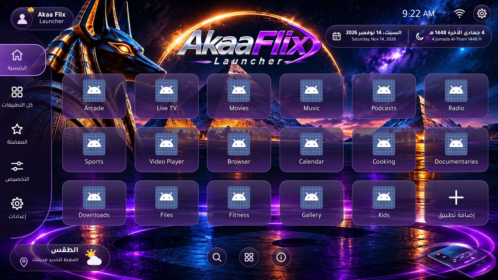
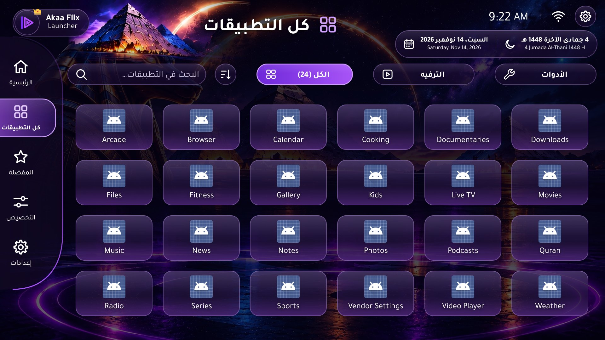
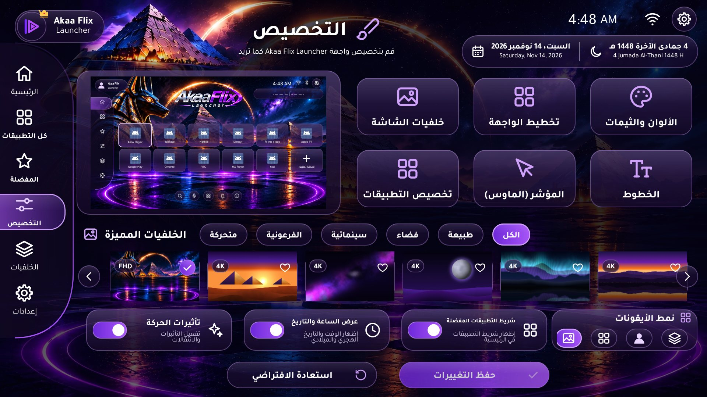
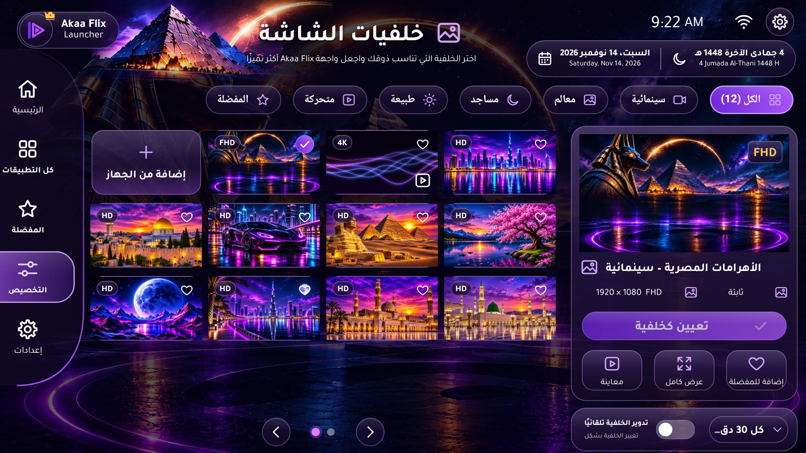
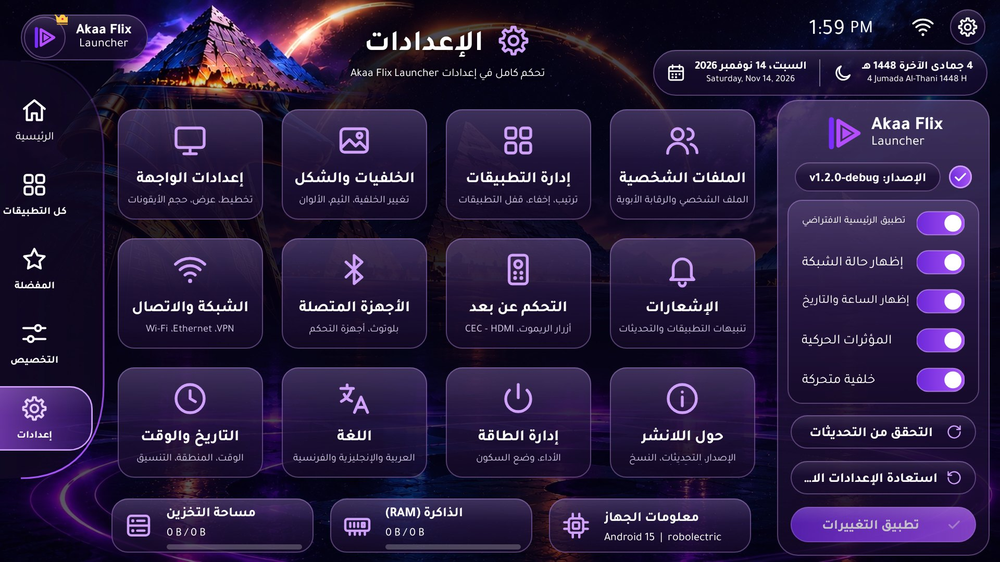
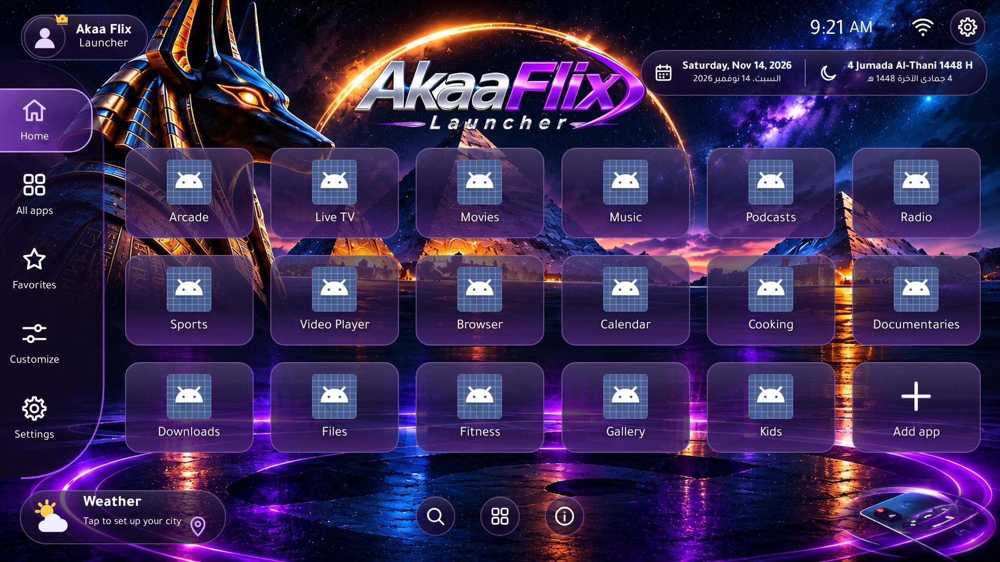

# Akaa Flix Launcher

A standalone Android **home-screen launcher** for Android TV, Google TV, Android TV boxes, tablets and
phones, built from the approved *Akaa Flix Launcher* design (Egyptian-futuristic, Anubis, pyramids,
purple/blue/silver/gold neon glass). Arabic-first (RTL) with full English and French (LTR).

It is **not** an IPTV app, media player or content platform: it lists and launches the apps that are
installed on the device. Akaa Player (or any other app) appears only as a normal installed app.

| Home (Arabic, TV 1080p) | All apps |
|---|---|
|  |  |
| **Customization** (live preview) | **Wallpapers** |
|  |  |
| **Settings** | **Home (English)** |
|  |  |

*Screenshots are rendered by the Robolectric screenshot test (`ScreenshotTest`) with brand-neutral sample
apps (test data), so app icons show Android's placeholder icon. On a device the launcher shows only the apps
that are really installed, with their real icons or Android TV banners. French and phone screenshots:
`docs/screenshots/tv_fr_*.jpg`, `docs/screenshots/phone_ar_*.jpg`.*

## Downloads

| File | Notes |
|---|---|
| [`release/AkaaFlixLauncher-v1.3.0-release.apk`](release/) | R8-minified release build (7.13 MB), signed with the persistent release key (RSA 4096, v1+v2+v3). Certificate SHA-256 `8ee47c472321a9f0045b3193f1d70bbb2df0893ed92f65833d8635a763873cdf`. Installs over v1.0.1 / v1.1.0 / v1.2.0 and keeps their settings. Release build only – no debug APK is shipped. |

v1.3.0: optional **Home button service** (accessibility, turned on by the user) so the remote's Home button
and start-up open Akaa Flix on Google TV / Xiaomi boxes; live Shizuku connection with reconnection; Shizuku
uninstall for user 0 – see [docs/V1.3_DELIVERY_REPORT.md](docs/V1.3_DELIVERY_REPORT.md).

v1.2.0: duplicate-entry fix (Play Store), real default-Home and start-up status with verification, App manager
for user and pre-installed apps with optional Shizuku, accurate device information, diagnostics – see
[docs/V1.2_DELIVERY_REPORT.md](docs/V1.2_DELIVERY_REPORT.md).

v1.1.0: neon remote focus, three-row Home, Favorites independent of Home, real weather with optional approximate
location, approved wallpaper collection, French, About page with the official website, app management for
user/system apps – see [docs/FEATURE_STATUS.md](docs/FEATURE_STATUS.md). v1.0.1 fixed the Google Play Protect
block of v1.0.0 – see [docs/SECURITY_AUDIT.md](docs/SECURITY_AUDIT.md).

SHA-256 checksums: `release/SHA256SUMS.txt`. Install instructions: [docs/BUILD_AND_INSTALL.md](docs/BUILD_AND_INSTALL.md).

## Features

**Launcher core**
- Registered as a Home app (`MAIN/HOME/DEFAULT`), plus `LAUNCHER` and `LEANBACK_LAUNCHER` entries so it can be
  opened from another launcher or the Google TV apps row. Back never exits; pressing Home returns to the home
  page (a second press resets focus).
- Real app discovery: phone apps via `LauncherApps` (work-profile aware) and Android TV apps via
  `CATEGORY_LEANBACK_LAUNCHER`, with a PackageManager fallback. Android 11+ package visibility through `<queries>`
  (no `QUERY_ALL_PACKAGES`). Live refresh on install/update/uninstall.
- Icon cache (memory LRU sized per device + PNG disk cache), adaptive-icon shapes, Android TV banners on cards,
  per-app neon under-glow from the icon's dominant colour.

**Pages (as in the reference design)**
- **Home** – logo, the Home apps (three rows by default, fitted between header and quick bar) with *Add app*,
  clock, Gregorian + Hijri date (Arabic / English / French), Wi-Fi/Ethernet status, weather widget (temperature,
  condition, high/low, city), quick bar (search, all apps, device info). Reorder directly on Home.
- **All apps** – search (Arabic letters and French accents normalised), filters *All / Entertainment / Tools*
  (no Games or System categories), sorting (custom, A–Z, Z–A, recently installed, most used, recently used),
  its own vertically scrolling grid, app options menu.
- **Favorites** – optional favourites, completely independent of the Home screen (adding to Home never adds a
  favourite and vice versa), plus the launcher's recently-used apps.
- **Customization** – live miniature preview of unsaved changes; wallpapers, interface layout, colours & themes,
  app cards, focus/cursor, fonts; motion, clock and Home-apps toggles; Medium/Large icon size; restore / save.
- **Wallpapers** (from Customization) – the approved collection: Egyptian Pyramids Cinematic (default),
  Animated Neon Pulse and the wallpapers of the approved PDF; categories, favourites, resolution badges,
  preview behind the UI, full-screen preview, add images/videos from the device, auto-rotation.
- **App management** – installation type (user / pre-installed / updated / protected); uninstall for user apps,
  Android App info for system apps (disable / uninstall updates only where the device allows it).
- **Settings** – 12 sections from the reference (interface, appearance, apps, profiles & parental controls,
  network, connected devices, remote control, notifications, date & time, language, power & performance,
  about/updates/backup), quick toggles panel, storage/RAM/device cards.

**Platform features**
- Remote-first navigation: neon focus (purple-magenta border, outer glow, inner light, zoom, smooth cross-fade),
  predictable D-pad routing between sidebar, top bar and content, focus memory, focus restoration after
  returning from apps, Menu-key and long-press actions, remote button test.
- Languages: Arabic (RTL), English and French (LTR) for every screen, dialog and message.
- Hijri calendar: embedded Umm al-Qura data (AH 1300–1600) validated day-by-day against the JDK, plus the
  arithmetical calendar and ±2-day adjustment. Western or Eastern Arabic numerals.
- Performance tiers (1 GB → 8 GB+ RAM) with an automatic and a manual **lightweight mode**.
- Parental PIN (PBKDF2-hashed) for apps, settings, customization and hidden apps.
- Backup & restore to a JSON file (never includes the PIN). Optional update check against GitHub releases.
- Crash guard: repeated crashes switch to a safe mode instead of a crash loop.

## Architecture

Kotlin, native Views (no Compose – lower startup cost and memory on 1 GB TV boxes), MVVM, coroutines/Flow,
Jetpack DataStore, AndroidX. No Room (no relational data), no DI framework, no analytics or ad SDKs.

```
app                 MainActivity (HOME), Application, boot receiver, crash guard, themes, manifest
launcher-core       design system (glass/neon drawables, switch, dialogs, PIN pad, setting rows), strings EN/AR,
                    icons, fonts, performance tiers, navigation contracts, safe intents
remote-navigation   D-pad focus routing (NavigationRootLayout), paged grids, key helpers
user-preferences    LauncherSettings / AppCustomization / wallpaper data (DataStore), backup codec, PIN hashing
device-information  clock ticker, Hijri calendar + date formatter, network & Bluetooth monitors, device info,
                    weather (Open-Meteo), system settings shortcuts, update checker
app-manager         app discovery & launching, icon cache, list logic, app card/grid, All apps & Favorites pages
wallpaper-engine    catalogue, memory-efficient decoder, host view (static/video/animated), rotation, Wallpapers page
home-screen         shell views (sidebar, top bar), Home page, dialogs, live Home preview
customization       Customization page (draft → save)
settings            Settings page and sections
tools/              generators: icons, strings (EN/AR source of truth)
```

Requirements: minSdk **23** (Android 6.0), compileSdk/targetSdk **37** (Android 17), AGP 9.5.1, Gradle 9.9.1, JDK 17+.

## Documentation

- [Build & installation](docs/BUILD_AND_INSTALL.md) – build commands, signing, installing, setting as default launcher (incl. Google TV)
- [Device compatibility report](docs/COMPATIBILITY.md) – what was verified and what was not
- [Performance](docs/PERFORMANCE.md) – optimisations, tiers, lightweight mode
- [Design specification](docs/DESIGN_SPEC.md) – measurements taken from the reference, decisions to confirm
- [Security & Play Protect audit](docs/SECURITY_AUDIT.md) – permissions, components, dependencies, signing
- [v1.3 delivery report](docs/V1.3_DELIVERY_REPORT.md) – Home button accessibility service, Shizuku connection handling, what works, limitations
- [v1.2 delivery report](docs/V1.2_DELIVERY_REPORT.md) – bugs, fixes, permissions model, tested versions, limitations
- [Xiaomi TV Box test plan](docs/XIAOMI_TEST_PLAN.md) and `tools/device_check.sh`
- [v1.1 feature status](docs/FEATURE_STATUS.md) – completed / unsupported features, control audit
- [v1.1 implementation checklist](docs/IMPLEMENTATION_CHECKLIST_v1.1.md)

## Permissions

| Permission | Why |
|---|---|
| `INTERNET` | Optional weather widget and *Check for updates* (both off until the user uses them) |
| `ACCESS_NETWORK_STATE`, `ACCESS_WIFI_STATE` | Wi-Fi / Ethernet status icon |
| `BLUETOOTH` (≤ Android 11) | Bluetooth on/off icon |
| Accessibility service *Home button* (`BIND_ACCESSIBILITY_SERVICE`, held by Android only) | Optional, turned on by the user in Settings → Accessibility on devices without a Home chooser (Google TV): the Home button and start-up open Akaa Flix. Receives only the Home key and the package/class name of new windows; no screen content, no typed text |
| `REQUEST_DELETE_PACKAGES` | "Uninstall" in the app menu opens the system uninstall dialog |
| `RECEIVE_BOOT_COMPLETED` | Optional "Start with device" on Android 6–9; keeps the weather refresh job scheduled after a restart |
| `QUERY_ALL_PACKAGES` | App manager: lists every installed package, including pre-installed ones without a launcher icon and packages removed for the user (stays on the device) |
| `moe.shizuku.manager.permission.API_V23` (from the Shizuku library) | Lets the user grant Akaa Flix access in the Shizuku app (optional) |
| `ACCESS_COARSE_LOCATION` (runtime, optional) | "Detect my location" for the weather city: asked only when the user taps it, after an explanation; one approximate fix, no tracking, no background location |

The only runtime permission is the optional approximate location above. No contacts, camera, microphone, SMS,
phone, storage/media, notification access, accessibility, overlay, usage access or device-admin. Wallpapers
are picked with the system photo/document picker (access to the chosen file only). Full details:
[docs/SECURITY_AUDIT.md](docs/SECURITY_AUDIT.md).

## Privacy

No accounts, ads, analytics or tracking. Everything works offline; the launcher contacts the network only for
the weather (Open-Meteo; city typed by the user or detected once from the approximate location, coordinates
rounded to ~1 km) and when the user checks for updates.
Settings stay on the device (Android cloud backup is disabled; use Settings → About → Back up settings).

## Licences

Fonts Tajawal and Cairo – SIL OFL 1.1 (`docs/licenses/`). Icons – original, in the style of the ISC-licensed
Lucide set. Akaa Flix branding, the default wallpaper and the wallpaper collection
(`design-assets/wallpapers/akaa-flix-wallpapers.pdf`) were supplied by the project owner; the Animated Neon Pulse
is drawn procedurally. Weather data: Open-Meteo (CC BY 4.0).
