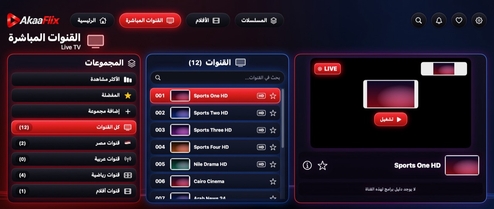
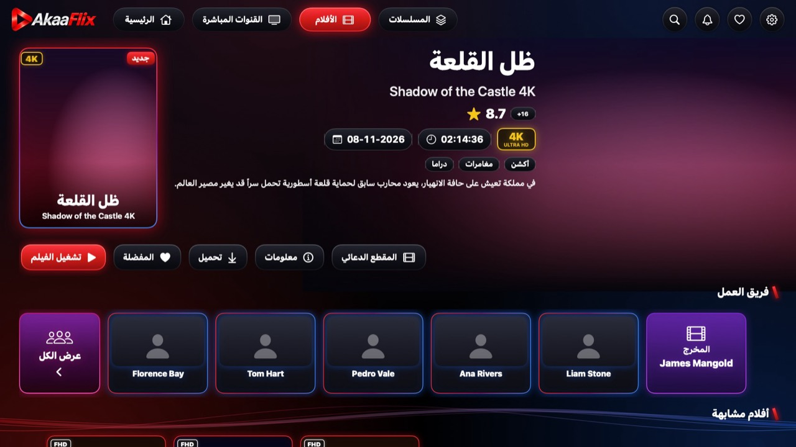
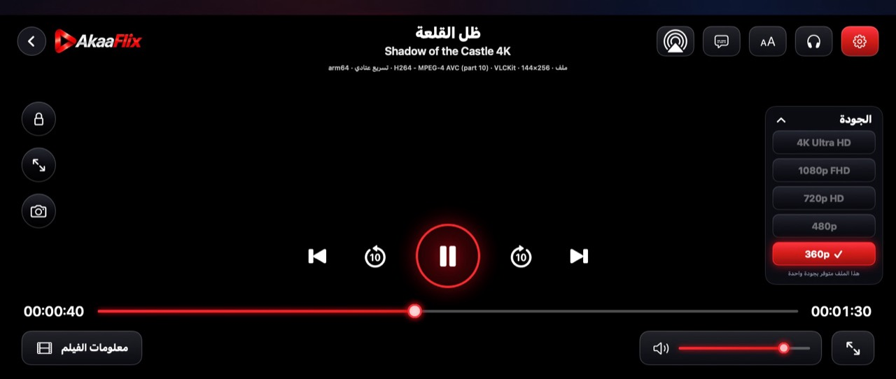
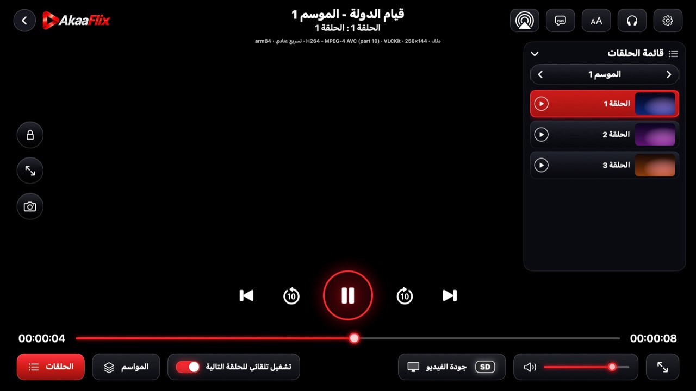
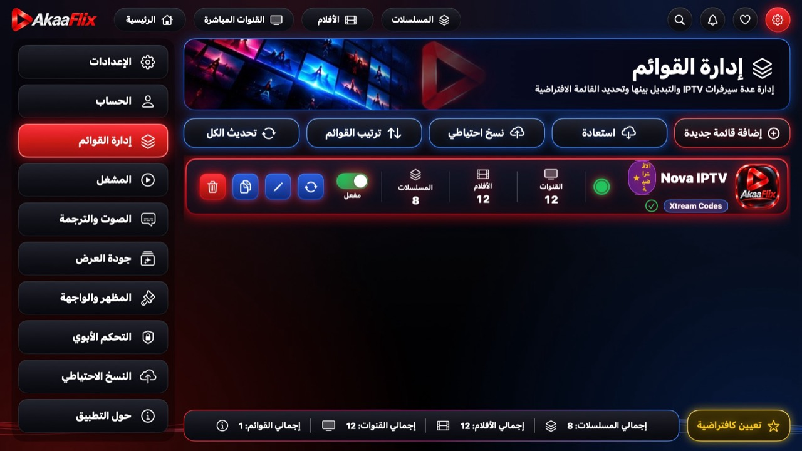
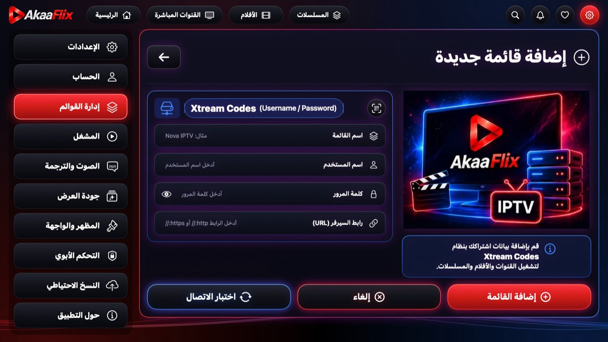
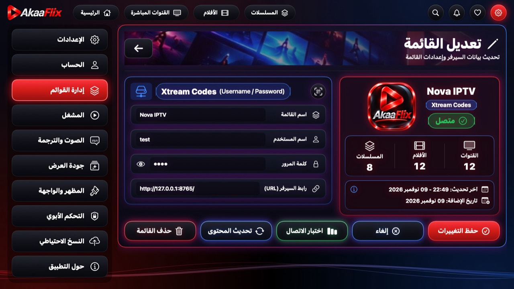
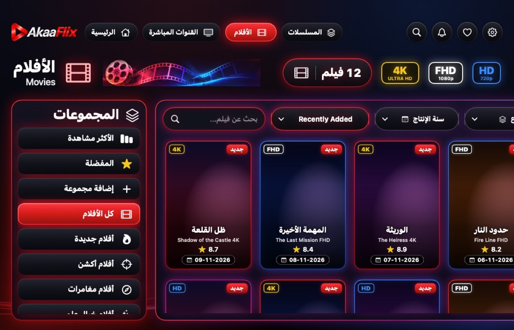
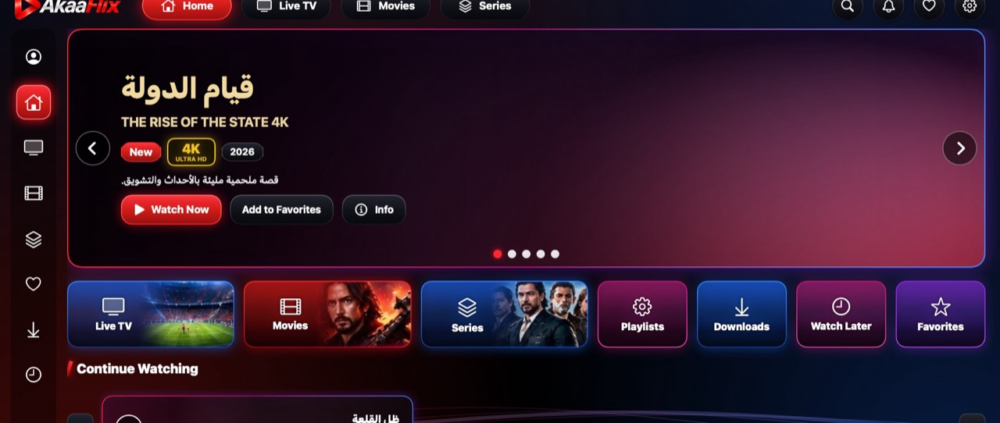

# Akaa Flix — native macOS app (Universal: Apple Silicon + Intel)

A native SwiftUI/AppKit IPTV player for **Xtream Codes** playlists: live TV, movies and series,
built from the approved Akaa Flix designs. One **Universal** binary (`arm64` + `x86_64`) runs
natively on every Apple Silicon Mac (M1 … M5 and later) and on Intel Macs, from
**macOS 11 Big Sur** through **macOS 26 Tahoe**.

> Akaa Flix does not provide channels or content. Users sign in with the Xtream Codes details from
> their own provider and should only connect to services they are authorised to use.

| | |
|---|---|
| App name | **Akaa Flix** (bundle id `com.akaaflix.mac`) |
| Version | **4.0.7** (build 407) — shown as *V4.0.7 for macOS* |
| Deployment target | **macOS 11.0** (see [Compatibility report](docs/COMPATIBILITY_REPORT.md)) |
| Architectures | `arm64` + `x86_64` in one bundle (verified with `lipo`) |
| Playback | VLCKit 3.7.3 (primary) + AVFoundation (fallback) |
| Live stream priority | **1. MPEG-TS (.ts) → 2. HLS (.m3u8)** — fixed, not user-editable |
| Languages | Arabic (default, right-to-left reading) and English |

## Screenshots

Captured automatically by the self-test on a GitHub macOS runner (design size 1670×940, mock
data and generated artwork — real posters and channel logos come from the user's playlist;
video areas are black because the off-screen capture cannot read the video layer).

| Home | Live TV |
|---|---|
|  |  |
| **Movies** | **Movie details** |
|  |  |
| **Movie player** | **Series details** |
|  |  |
| **Series player** | **Settings · Player (fixed MPEG-TS → HLS)** |
|  |  |
| **Playlist management** | **Add playlist** |
|  |  |
| **Edit playlist** | **About** |
|  |  |
| **Minimum window (1100×680)** | **English** |
|  |  |

## Features

- **Playlists:** Xtream Codes only — add / edit / test / refresh / duplicate / delete / enable,
  default playlist, drag-to-reorder, QR-code import (camera or image), backup & restore.
- **Home:** hero banner, shortcut tiles, Continue Watching, Most Watched, recently added rows.
- **Live TV:** groups with counts, favourites, custom groups, search, preview player with
  LIVE badge, EPG (now/next), full-screen live player with channel up/down, EPG overlay, pin
  (keep on top) and mini player.
- **Movies / Series:** poster grids with 4K/FHD/HD and “New” badges, filters (search, sort, year,
  genre, quality), details pages (cast, similar titles, trailer, download), seasons and episodes
  with per-episode progress.
- **Players:** play/pause, ±10 s, previous/next, timeline, volume, quality menu (adaptive
  streams), audio tracks, embedded and external subtitles (SRT/VTT/ASS) with sync, subtitle size
  and colour, aspect ratio, speed, snapshot, lock, AirPlay route picker, full screen, playback
  info (format · resolution · codec · engine · hardware/software decoding · architecture).
- **Continue Watching & automatic next episode** with a countdown that crosses seasons.
- **Settings:** general, account (all data from the server), playlists, player, audio & subtitles,
  display quality, appearance, parental control (PBKDF2-hashed PIN, locks, age limit, hidden
  content), backup, about.
- **Downloads** (when the provider allows) and local notifications for new content/expiry.

## Repository layout

```
macos/
├── AkaaFlix.xcodeproj         Xcode project (generated by tools/generate_xcodeproj.py — commit after regenerating)
├── AkaaFlix/
│   ├── Core/                  Foundation-only logic: models, Xtream client/parser, stream policy, SQLite stores,
│   │                          settings, PIN hashing, backup, next-episode rules (also compiled into the tests)
│   ├── App/                   App entry, AppModel (state/navigation), root views, top bar
│   ├── Player/                PlaybackEngine protocol, VLCKit engine, AVFoundation engine, PlayerController, player UI
│   ├── Screens/               Home, Live TV, Catalog, Details, Settings, Playlists, Library, About
│   ├── Components/ Theme/     Approved design system (neon panels, pills, badges, toggles, cards, colours)
│   ├── Services/              Image cache, Keychain, downloads, QR scanner, system/architecture detection
│   ├── SelfTest/              End-to-end self-test harness (--self-test)
│   ├── Resources/             Assets.xcassets (app icon, logo, approved artwork), third-party notices
│   ├── Info.plist, AkaaFlix.entitlements
├── AkaaFlixTests/             XCTest unit tests (stream priority, failover, parser, DB, backup, crypto…)
├── Config/                    Base / Development / Testing / Release .xcconfig (+ Signing.example)
├── SelfTest/                  MOCK Xtream server + tiny media fixtures used only by CI
├── scripts/                   fetch-vlckit, build, verify-universal, make-dmg, notarize, run-selftest
├── tools/                     Xcode project and asset generators
├── branding/                  Approved logo / icon / artwork sources (cut from the brand PDF)
└── docs/                      Install guide, compatibility report, dependency review
```

## Building

Requirements: a Mac with **Xcode 16 or newer** (CI uses Xcode 16.4 and Xcode 26).

```bash
cd macos
scripts/fetch-vlckit.sh          # downloads + verifies the universal VLCKit.xcframework into Vendor/
open AkaaFlix.xcodeproj          # scheme "Akaa Flix": Run = Development, Test = Testing, Archive = Release
```

Command line:

```bash
scripts/build.sh Release        # Universal app → build/Release/Akaa Flix.app (+ verification)
```

```bash
scripts/make-dmg.sh "build/Release/Akaa Flix.app" build/dmg Universal
```

```bash
xcodebuild -project AkaaFlix.xcodeproj -scheme "Akaa Flix" -configuration Testing test
```

### Build configurations

| Configuration | Purpose | Architectures | Bundle id | Notes |
|---|---|---|---|---|
| **Development** | Day-to-day work | active arch | `com.akaaflix.mac.dev` | `-Onone`, `DEBUG` |
| **Testing** | Scheme *Test* action / QA | active arch | `com.akaaflix.mac.testing` | testability on |
| **Release** | Distribution | **arm64 + x86_64** | `com.akaaflix.mac` | `-O` whole-module, dSYM, Hardened Runtime, signing from `Config/Signing.xcconfig` |

## Packaging strategy

1. **One Universal app bundle** — every Mach-O (app executable, VLCKit, Swift back-deploy
   libraries) contains both `arm64` and `x86_64`. `scripts/verify-universal.sh` fails the build if
   any binary lacks an architecture or requires a macOS newer than 11.0.
2. **One Universal DMG** (`AkaaFlix-4.0.7-Universal.dmg`) with an Applications shortcut, plus a
   zipped app. Separate Intel-only / Apple-Silicon-only builds are **not needed** because the only
   third-party dependency (VLCKit 3.7.3) ships a universal framework. `scripts/make-dmg.sh` accepts
   a suffix if thin builds are ever required (e.g. `xcodebuild … ARCHS=x86_64`).
3. **Signing:** Hardened Runtime is always on. Without a Developer ID the app is ad-hoc signed
   (runs after the Gatekeeper confirmation described in [INSTALL.md](docs/INSTALL.md)). With the
   Developer ID secrets configured, CI signs with a secure timestamp, notarizes the DMG with
   `notarytool` and staples the ticket. **No build is described as notarized unless that step
   succeeded.**

## Architecture notes

- `LiveStreamPolicy.mandatoryOrder = [.mpegTS, .hls]` is a constant; settings contain no field for
  the order, and decoding a settings file strips MPEG-TS/HLS from the optional list. Optional
  DASH/RTMP/RTSP/HTTP attempts can only be appended after the two mandatory formats.
- `FailoverPlanner` (engine-agnostic): a failure before playback starts moves to the next format;
  a drop after playback reconnects from the top (MPEG-TS first) with back-off.
- `EngineFactory` picks VLCKit on both architectures; `SystemInfo` reports the running slice,
  Rosetta translation (`sysctl.proc_translated`) and the CPU, shown in About and in the playback
  info line. Hardware decoding uses VideoToolbox on Intel and Apple Silicon with automatic
  libavcodec software fallback; *Settings → Display quality → Decoding* can force software decoding.
- The window chrome keeps the approved left-to-right placement (logo, tabs, round icons) while
  rows and text read right-to-left in Arabic.

## Testing

- **Unit tests** (`AkaaFlixTests`, Testing configuration): stream priority and URL building,
  failover/reconnect, Xtream parsing of inconsistent JSON, server URL normalisation, SQLite
  catalog queries/filters/hidden content, Continue Watching, most watched, groups, backup round
  trip, SHA-256/PBKDF2 vectors, PIN hashing, next-episode navigation, QR link parsing, client
  scheme fallback and partial sync failures.
- **End-to-end self-test** (`scripts/run-selftest.sh`): launches the real app bundle with
  `--self-test` against `SelfTest/mock_xtream_server.py` (a clearly labelled mock) and checks
  startup, native architecture, authentication, catalog sync, database persistence, MPEG-TS live
  playback, the HLS fallback when MPEG-TS fails, channel switching, movie playback with two audio
  tracks and external subtitles, seek + Continue Watching, full screen, series playback with
  automatic next episode, window resizing and shutdown — and captures screenshots of every screen.
  CI runs it on Apple Silicon and Intel runners; results are in the
  [compatibility report](docs/COMPATIBILITY_REPORT.md).

## Licences

VLCKit/libVLC are LGPL-2.1 and are dynamically linked as a replaceable framework; see
`AkaaFlix/Resources/ThirdPartyNotices.txt` and [docs/DEPENDENCIES.md](docs/DEPENDENCIES.md).
